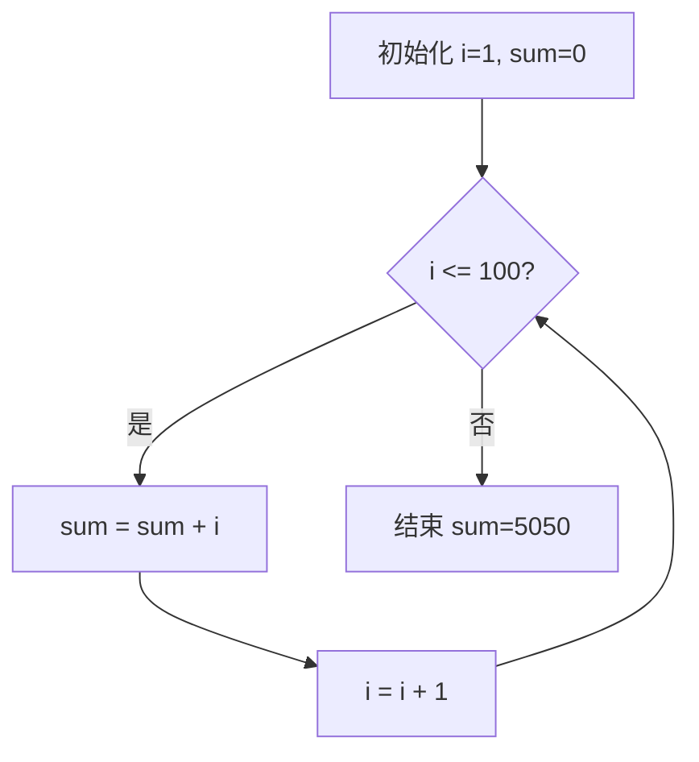

# D2：能观察客户程序的调试器

本章对应 [D2 原文](sources/D2.md)以及冻结的 PA1 简易调试器、表达式、监视点和必答题。已完成的机器证据是 [表达式验证](../../reports/D2_expression.json)、[真实 NEMU 交互验证](../../reports/D2_sdb.json)和 [PA1 源码快照清单](snapshot/manifest.json)。此时仍保留官方 PA1 的四指令初始客户程序；RV32IM 的完成证据将在 D3 单独给出。

## 1. 先确定观察哪一台机器

GDB 调试的是宿主 C 程序；NEMU 中的 SDB 观察的是客户 RISC-V 机器。宿主的 `$pc` 和 NEMU 的 `$pc` 不是同一个量。客户机器状态可表示为 `(PC, GPR, 内存)`：执行一条指令后，这些状态发生一次转移，调试器应在该转移结束后停下。

采用这个边界的原因是：若在译码中途停下，PC、寄存器和内存可能来自不同时刻。实现中先执行指令、更新 PC，再检查所有监视点；值变化时把状态改为 `NEMU_STOP`，交还命令循环。

| 命令 | 本实现行为 | 实际检查 |
|---|---|---|
| `si [N]` | 默认 1 条，正整数，最多 1000000 条 | 内置程序执行 1 条后 PC 为 `0x80000004`，再 2 条为 `0x8000000c` |
| `info r` | 32 个 GPR、ABI 名和 PC | `t0` 与首条 `auipc` 一致，x0 保持零 |
| `x N EXPR` | 从表达式地址读连续 N 个 32 位 RAM 字 | 与原始四条指令和数据 `0xdeadbeef` 对照 |
| `p EXPR` | 无符号 32 位求值 | 固定边界、寄存器、内存及 10000 个编译器参照样例 |
| `w EXPR` | 保存初值，每条客户指令后重算 | 首次寄存器变化、首次内存写入均在正确 PC 停下 |
| `info w` / `d ID` | 列出、释放与回收槽位 | 32 个槽位耗尽，删除头/中/尾后再分配 |
| `c` / `q` | 继续或正常退出 | 正常陷入 GOOD TRAP；`q` 不误报客户失败 |

扫描与解引用仅允许 RAM 范围，不触发 MMIO 副作用。错误命令、缺参、负计数、越界地址、非法表达式均返回诊断，后续 `p 42` 仍能正常工作。完整会话在 [commands](commands)及工程 `artifacts/D2/sdb`。

## 2. 表达式：从字符到可检验的语义

实现分为两步。词法阶段用 POSIX 正则将数字、寄存器名、运算符和括号分成 token；语法阶段按优先级递归求值。乘法、除法高于加减，比较高于逻辑与，二元运算采用左结合。前缀位置的 `*` 是取 32 位客户内存，后缀已有左操作数时的 `*` 是乘法。

所有算术结果采用 `uint32_t`，所以 `0xffffffff + 1` 为 0，`-1` 是 `0xffffffff`。这里的解引用没有 C 指针类型推导，而是课程约定的读取一个 32 位值。无效寄存器通过回调明确返回失败，不能悄悄返回 0。

`&&` 和补充支持的 `||` 使用短路语义。`0 && 1/0` 与 `1 || *0` 不执行右侧危险操作；但 `0 && (1+)` 仍是语法错误，不能借短路忽略非法语法。文本、token 数、寄存器名长度、递归深度和整数溢出均有边界。

测试中发现过 `10u` 的后缀处理使词法游标少走一字节；先保留失败，再修复为“转换使用的字符串长度”和“原输入消费长度”分开处理。这个例子说明，词法器看似简单也会把后续语义全部带偏。

## 3. 10000 个表达式的参照从哪里来

[gen_expr.c](gen_expr.c)使用确定种子 `0x2607d2`，生成带不同空白和括号深度的合法算术表达式。所有常量在送给 GCC 时增加无符号后缀；除数由构造保证非零，避免给参照程序引入 C 未定义行为。

每 128 个表达式组成一个真实 C 程序，编译并执行后得到结果。这与把待测求值器自己跑一遍来“生成答案”不同：数值参照来自 GCC 编译的 C 表达式。生成器用 `fork/exec/waitpid` 管理编译和执行，检查每次子进程退出码；没有把编译失败当成结果 0。

10000 条均与待测求值器一致。另有固定用例检查寄存器和客户内存，因为宿主 C 的指针含义无法直接替代客户内存回调。把加法故意改为减法后，同一套断言真实拒绝错误版本。固定与随机测试都只是已覆盖输入上的证据，不是对所有字符串的形式化证明。

## 4. 监视点为什么需要两个链表

32 个槽位分别属于“使用中”和“空闲”两条链。申请把一个槽位从空闲链移到活动链；释放做相反操作。编号是稳定的槽位索引，释放后允许复用。每次变动检查：两链不成环、不重叠、所有 32 个槽位恰好出现一次，槽位的 active 标志与所属链一致。

池满是可恢复的用户输入错误，本实现输出诊断而不终止整个 NEMU。监视表达式若在运行中变为非法，例如分母从非零变为零，会停下并给出 `WATCH_ERROR`，而非假装“没有变化”。同一条指令引起多个监视点变化时，逐个报告并统一停一次。

`CONFIG_WATCHPOINT` 是单独的 Kconfig 开关。启用时在提交后检查；关闭时设置命令明确提示功能被配置关闭。所有正式交互用例使用启用配置，不以关闭监视点换取测试通过。

## 5. PA1 必答题

### 程序的状态机

计算 `1+2+…+100` 的状态写成 `(位置 p, i, sum)`。初始化令 `i=1,sum=0`；条件检查 `i<=100`；成立时令 `sum←sum+i`，再令 `i←i+1`，回到条件；不成立则结束。循环头不变式为 `sum=(i-1)i/2`，最终 `i=101,sum=5050`。

状态机不能只画一个“加法”方框而省掉控制位置，否则无法区分正在判断条件、执行累加还是执行自增。映射到 RISC-V 后，控制位置由 PC 表示，变量位于寄存器或内存。

### 基础设施的时间收益

按题目假设，调试次数为 `500×90%=450`。只用宿主 GDB 提取客户信息的时间为 `450×20×30=270000` 秒，即 75 小时；SDB 为 `450×20×10=90000` 秒，即 25 小时，节省 50 小时。这是题设模型的计算，不是本项目实际耗时统计。

### 如何在 RISC-V 手册中定位

使用归档中的 `riscv-isa-manual` 固定提交 `7a90b34e1a04e57a65bfd9de9a3b4e8dc2c5ddc8`，避免把不断变化的主分支当作固定版号。

- 指令格式：`src/unpriv/rv32.adoc` 的 **Base Instruction Formats** 和 **Immediate Encoding Variants**。四个核心格式 R/I/S/U，加上立即数布局的 B/J 变体；通常教学中合称六种。
- LUI：同文件整数运算部分的 **Integer Register-Immediate Instructions**，将 U 立即数放到结果高 20 位，低 12 位补零；这里是 RV32，结果写入 32 位目标寄存器。
- mstatus：`src/priv/machine.adoc` 的机器状态寄存器章节，图锚点 `mstatusreg-rv32`，并同时看 RV32 的 `mstatush`。不能拿 RV64 的单幅图直接冒充 RV32 的全部布局；字段还受所实现扩展约束。

定位到这些章节不等于本阶段实现了全部特权寄存器。D2 只建立调试器；后续的异常与操作系统另有阶段范围。

### 源码行数与过去版本

统计口径为 NEMU 下全部框架/作者 `.c`、`.h`，排除 `.git`、构建目录、下载的 `repo`、生成的配置头；同样口径应用于原始框架和 PA1 快照。最终数字见 [D2_sdb.json](../../reports/D2_sdb.json)的 `source_line_counts`，原框架为 114 文件、17516 行、15301 非空行。本次大量替换旧空白与 TODO，所以净行数可以减少；“净增加多少行”不等于“亲手写了多少行”。

相应 shell 方法是先列出上述范围的 C/H 文件，再分别 `wc -l` 和过滤空行计数；实际验收器以相同规则逐文件读取，保存原始计数。Git 的基线提交和不可变 PA1 快照保留了过去状态，不需要破坏当前目录来回退查看。

### `-Wall` 与 `-Werror`

`-Wall` 启用一组常见警告，`-Werror` 将启用的警告提升为错误。它们不能证明程序无 bug，但能在运行前发现很多可疑代码。本项目确实遇到并修复了严格构建指出的缩进歧义，保留该失败；没有关闭警告绕过它。

## 6. FAQ、范围与复验

FAQ 强调的是跨抽象层理解、独立调试、查手册和对代码正确性负责，而不是只拼出一个会打印 GOOD TRAP 的程序。本次产物是明确标注的本地代理实现与可审查工程证据，不代表用户已经独立完成官方考核。未向课程平台提交、未使用个人学号、未联系教师；官方提交流程按既定范围排除。MOOC 链接仅作为补充课程索引，没有声称已听完全部课程。

复验顺序：先运行 [verify_expr.py](verify_expr.py)，再在独立 D 工作目录中运行 [build_nemu.py](build_nemu.py)和 [verify_sdb.py](verify_sdb.py)。后两者构建的是 PA1 范围；D3 开始后应使用快照恢复到新目录复验，不覆盖更高阶段的运行目录。已冻结快照包含当时的源文件、配置、ASan 可执行文件和匹配的 Capstone 库。

实际 NEMU 的五组命令会话均在 AddressSanitizer（含泄漏检测）下通过；共享表达式/监视点核心另外通过 ASan 与 UBSan。其意义限于本次执行的路径，不能替代所有输入的证明。
