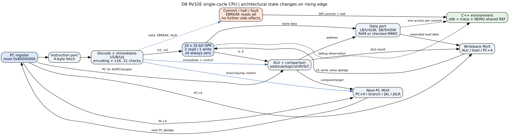

# D8：RV32E NPC、调试基础设施与软件回归

本节按[固定课程原文](sources/D8.md)实现公开工程任务。入口是 [rv32e_core.sv](rv32e_core.sv)、[runner.cpp](runner.cpp)和[阶段审计](../../reports/D8_AUDIT.json)。这是独立实现与有限验证，不代表官方课程提交、个人学习掌握或完整 ISA 认证。

## 从一条指令理解单周期数据通路



PC 从 `0x80000000` 取出 32 位指令，译码提取寄存器编号和立即数。寄存器文件给出两个源操作数；ALU 完成运算、比较或地址生成。写回选择 ALU、load 数据或 PC+4，下一 PC 选择顺序地址、分支地址或跳转地址。状态在上升沿提交，C++ 在提交边界观察寄存器、访存和退出事件。

例如 `lw a0,4(sp)` 先将符号扩展的立即数 4 与 sp 相加，再检查地址及字对齐，读取四个字节，最后写 a0；`sw` 使用相同地址计算，但从 rs2 取写数据。`jalr rd,imm(rs1)` 必须先用旧 rs1 计算目标，再写 rd=PC+4，且清除目标最低位。本实现还要求目标满足 4 字节对齐，因此 bit1=1 会报错。

16 个通用寄存器均为 32 位，x0 固定为零；读写 x16–x31 的有效寄存器字段会触发故障。支持 RV32E 的基础整数计算、六种分支、跳转、LB/LBU/LH/LHU/LW、SB/SH/SW。没有 M/C/CSR/特权或中断实现。FENCE 在单 hart、无缓存、同步内存模型下完成，FENCE.I 也按无指令缓存环境处理，不据此宣称缓存一致性已验证。EBREAK 是仿真退出约定，通过 a0 区分 GOOD_TRAP 与 BAD_TRAP。

与常见教科书单周期图相比，这里仍有 PC、寄存器文件、ALU、数据存储和两个选择器；另外显式表示了编码/对齐错误、提交观察、退出与设备模型。图中的取指端口和数据端口由宿主内存实现，不是已经流片的双端口 SRAM。两种图各自强调教学数据流或可调试实现，不能仅按图的复杂程度判断性能优劣。当前 RTL 无流水线、缓存和总线等待状态，D6 的流水灯 PVT 数字也不是本 CPU 的频率。

## SDB、trace 和 DiffTest 分别解决什么问题

SDB 支持 `si`、`c`、`info r`、`x`、`p`、`w`、`d`、`q`。寄存器经稳定的 RTL 调试端口读取，表达式与监视点复用 D2 的解析器。内存扫描仅检查 RAM，不产生设备副作用。监视点在一条指令提交后比较，因此能够给出导致变化后的 PC，而不是任意半个时钟的内部值。[测试](../../reports/D8_front.json)检查三次监视点命中、非法命令、寄存器越界和错误表达式。

itrace 记录 PC、编码和 Capstone 反汇编；mtrace 记录已经提交的读写；ftrace 从 ELF 的 STT_FUNC 符号识别调用、返回和尾调用。默认不开日志，可按 `--trace-modes imf` 开启，`--trace-limit` 限制输出；环形历史保留最近 16 条。剥离符号后仍能执行指令跟踪，但函数名不可凭空恢复。D7 的同一 ELF 解析器对 55 个损坏/边界样本经过 ASAN/UBSAN，缺失或损坏 ELF 有明确诊断。

DiffTest 通过 `dlopen` 装入独立编译的 NEMU shared REF。ABI 为 32 个 uint32 寄存器加一个 PC，共 132 字节；RV32E 只使用前 16 个，REF 的后 16 个必须保持零。`memcpy`、`regcpy` 支持两个方向，`exec` 执行真实参考指令，`init` 重置状态；`raise_intr` 明确拒绝本阶段不支持的功能。[API 验证](../../reports/D8_reference.json)包括 1000 次拷贝、寄存器、执行/存取及越界负例。

每次普通提交比较 PC 和全部 REF 寄存器；每次 RAM store 还独立读回参考内存。设备访问不能简单让两个独立计时器或随机 UART 恰好相同：此处先在宿主按指令编码、有效地址、宽度、写数据和预期状态验证设备操作，再同步 REF。报告分别列出 `diff_checked` 与 `device_sync_checked`，二者相加等于提交数。后者不是两个独立设备模型的一致性证明。EBREAK 在 REF 中实际执行，没有笼统跳过。

故意把真实 RTL 的 ADDI 结果加 1，DiffTest 在第 2 条指令、PC=`0x80000004` 检出差异；不是只测试比较函数自身。四值 Icarus 测试另外覆盖未知初值、复位、halt/fault 后复位及错误复位 mutant，避免用 Verilator 的初值行为替代复位验证。

## 编译、halt 与库

AM 选择 `-march=rv32e -mabi=ilp32e`，每个官方测试检查 RVE ELF 标志和 ISA attributes；不能把 RV32IM 镜像换个文件名就算 RV32E。`make ARCH=riscv32e-npc run` 负责生成 ELF、提取镜像并调用 NPC。halt 保证只提交一次退出事件且不再修改内存；原始 wrong 程序产生 BAD_TRAP，外层 make 返回 2。

同样的加法器不携带“有符号”标签：有限位宽加法产生相同位模式，解释由指令和后续使用决定。实际编译的 signed_add 和 unsigned_add 指令编码相同；signed_less 与 unsigned_less 则分别使用 SLT、SLTU。C 的 signed overflow 仍是未定义行为，不能用底层加法相同推导出 C 编译器必须保留溢出行为。

没有 M 扩展时，C 乘除法可由移位、加减、比较和循环实现，编译器调用 AM 提供的整数运算辅助函数。官方 mul/div C 测试已经实际通过；直接输入 MUL 编码仍然被拒绝。原来 8 个 RV32M 汇编程序属于 D3 的验证范围，不是可以原样编译到 RV32E 的正例。

klib 由本工程独立实现并按平台实测，算法与限制见 [D5 说明](../D5/NOTES.md)。为 archbench 增加的内存文件层提供受限 FILE API、整数扫描和写时复制，不实现宿主文件系统、浮点扫描或 glibc 内部 FILE 布局。主机对照 531 项及 EOF mutant 见 [文件层报告](../../reports/D8_fileio.json)。未修改原应用输入或 checksum 来迎合实现。

早期分配器在图划分 train 中耗时过长。诊断发现大量已分配块与少量空闲块，改为分离空闲链表、维护物理相邻关系和局部合并；保留旧代码、停止记录及 10000 次随机操作验证。新版本该程序运行 86817653 条指令，接受记录中耗时约 46.12 秒。旧版本被中止，没有完整结束时间，因此不报告精确加速倍数。

## ALU 综合实验

对 4 位 ALU 用 Yosys 实际综合。直接写运算符时，粗粒度结果仍有一个 add、一个 sub 和两个 lt；本次流程没有把这些功能全部归并到同一个加法器。手工共享方案在同一通用门映射流程得到 126 个单元，直接方案为 114 个，因此“手工共享一定更省面积”不成立。具体统计见 [D8_alu.json](../../reports/D8_alu.json)。

可变移位综合为按移位量位控制的多级选择网络，例如 4 位移位可以选择移 1 位和移 2 位；算术右移的补位取符号位。综合器可以优化常量和互斥逻辑，但共享也引入选择器与控制路径，是否改善面积/延迟要在实际库与约束下评估。本次是通用门数，不是 μm² 或 ns。

两个方案在全部 2048 组 `(a,b,op)` 上通过组合 SAT 等价，错误进位解释 mutant 被拒绝。这是 4 位组合模块的完整输入证明，不能扩展成 32 位 CPU 的完整证明。

## 本次实际回归范围

| 测试层 | 实际完成 | 证据 |
| --- | --- | --- |
| 独立指令期望 + NEMU 比较 | 1758 个边界检查 | [ISA](../../reports/D8_isa.json) |
| 官方程序重新编译 | 38 个 RV32I 汇编 + 35 个 C 测试 | [73 个测试](../../reports/D8_official_tests.json) |
| 应用小输入 | 三个 benchmark 及 21 个 archbench，各 native/RV32E，共 48 次 | [test（补充包：reports/D8_apps_test.json）](https://github.com/Bai-Lee/ysyx-f-to-b/releases/tag/v1.0.0) |
| train 输入 | 20 个非 hello archbench，100 MHz 周期计时模型 | [train](../../reports/D8_apps_train.json) |
| klib | 同一 5007 项便携测试编译到 RV32E | [附加检查](../../reports/D8_extra.json) |
| 早期自编测试 | 12 项逐一迁移/核对，保留地址布局差异 | [旧用例](../../reports/D8_prior_tests.json) |
| 官方 AM 时钟 | 观察 1/2/3 秒，按输出条件结束 | [计时器](../../reports/D8_timer.json) |
| FCEUX 原生 | 真实 SDL 图像、J 按下/释放、440/220/440 Hz 音频回调 | [原生](../../reports/D8_fceux_native.json) |
| FCEUX NPC | 两帧完整字符图像，在第三帧头停止 | [字符帧](../../reports/D8_fceux_ascii.json) |
| 原生官方键盘 | J、左箭头按下/释放，正常 SDL 退出 | [键盘](../../reports/D8_native_keyboard.json) |

计时器菜单原源码还引用中断 API，因此仅该测试加入显式报错的链接桩；选择中断菜单会 BAD_TRAP，证明没有伪造中断成功。源文件和正常计时器逻辑保持原样。早期零地址 RAM 测试迁到 `0x80000000`，原地址回绕至 0 的访问则应被新环境拒绝。正例中故意返回非零的历史测试按独立寄存器期望验收，仍保留 BAD_TRAP 字样。全部适配逐项写在报告中。

D8 没有要求重做 E7 的 SoC 外设/虚拟板或 E8 的物理签核；这两部分继续保留其原版本证据。train 本次使用一个明确的周期频率模型，没有借用 E6 旧 CPU 的综合频率来冒充新 CPU 的时序。FCEUX 使用自制 CC0 ROM、隔离 Xvfb 和实际 SDL PCM 捕获；未测试物理扬声器，也未声称无限期游戏稳定。

## 使用与复验

当前 Linux 工作台为 `/home/USER/d-stage/workbench`，发行版 `YSYX-Linux`，用户 `ysyx`。例如在该环境中设置 `AM_HOME`、`NPC_HOME`、`VERILATOR_ROOT` 后，到 `am-kernels/tests/cpu-tests` 执行：

```sh
make -j1 ARCH=riscv32e-npc ALL=dummy run
```

裸模拟器可用 `--image`、`--elf`、`--ref`、`--report` 指定各文件，加 `--interactive` 进入 SDB。真实参数和文件哈希以 `artifacts/D8/*/run.json` 为准。日常只读核验使用 [Verify-D.ps1](../../scripts/Verify-D.ps1)。重跑会保留旧尝试，但会改写当前工作台产物，应先读[离线与恢复说明](../offline/README.md)。不要在最终工作台重新运行 D2/D3 的历史初始化器。
