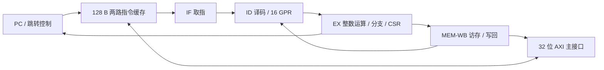

# 最终 B 处理器

CPU 是 RV32E 教学实现：32 位整数数据通路、16 个通用寄存器、单核、单发射、顺序执行。四级为 IF、ID、EX、MEM-WB，包含数据转发、连续命中取指与提前计算的 JAL 目标。

该图表达逻辑关系，不是时序路径报告。完整课程 SoC 还包含总线桥、UART、SPI/PSRAM、SDRAM 等控制器和数字功能模型；这些外设不包含在 CPU 单元面积数值内。

| 项目 | 支持情况 |
|---|---|
| 指令与 ABI | 基础 RV32E，以及已实现的必要 CSR / `fence.i` 行为；软件使用 ilp32e |
| 指令缓存 | 4 行、2 路/2 组、每行 8 个 32 位字，总计 128 B |
| 异常与上下文 | M 模式同步 ECALL/MRET、必要 CSR、mcycle；有限 OS 工作负载 |
| 通用编程 | 能执行适配并编译的 C/汇编和较复杂的有限程序 |
| 尚未实现 | 完整特权架构、异步抢占、MMU、数据缓存、BTB、返回地址栈、硬件 FPU |

它能执行通用算法，但不是可直接替换个人电脑处理器的平台。既有 x86/ARM 可执行程序不能直接运行。Linux/Android/桌面软件的完整移植没有实现或验证；RT-Thread 的同步切换也不能当作完整异步抢占支持。

源码入口：[顶层](../B/soc/rtl/ysyx_00000000.v)、[流水线](../B/soc/rtl/ysyx_00000000_pipe.sv)、[缓存](../B/soc/rtl/ysyx_00000000_icache.sv)、[ALU](../B/soc/rtl/ysyx_00000000_alu.sv)。`ysyx_00000000` 是占位模块前缀，`marchid=0x26070001` 是本地教学识别常量，两者都不是个人学号或官方资格。

