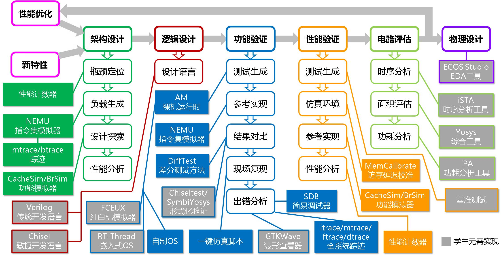

<!-- SOURCE: https://ysyx.oscc.cc/docs/2607/f/6.html | VERSION: v26.07 | CAPTURED: 2026-10-23T10:38:49.198071+00:00 | RAW_SHA256: 85a7a0e4d022136b390d3335b22a7a372c54cfb8d7cdfbc0af10629f275be6a3 -->

<!-- 公式图为网页原始SVG；可读转录及校验见 inventory/formulas/a8550640d079226c.json，转录不是作者原始LaTeX。 -->

<a id="f6-简易输入输出"></a>


# F6 简易输入输出

你已经在Logisim中设计了sCPU, 并运行了数列求和程序. 在这一小节中, 我们尝试为sCPU添加输入输出功能, 并尝试运行更多的程序.

<a id="sisa-v2-0"></a>


## sISA v2.0

<a id="sisa指令的局限性"></a>


### sISA指令的局限性

虽然sCPU已经可以运行数列求和程序, 但由于sISA的局限性, 很难运行更复杂的程序. 一些局限性如下:

- PC寄存器的位宽只有8位, 因此程序最多只能包含256条指令
- GPR只有4个, 因此程序最多同时存在4个使用中的变量
- `li`指令只能装入`0`~`15`的立即数, 如果要装入大常数, 需要利用多条`li`指令和`add`指令进行累加. 例如, 要装入`192`, 就要通过类似以下的指令序列来完成

  

```text
0: li r0, 3
1: add r0, r0, r0  # r0 = 6
2: add r0, r0, r0  # r0 = 12
3: add r0, r0, r0  # r0 = 24
4: add r0, r0, r0  # r0 = 48
5: add r0, r0, r0  # r0 = 96
6: add r0, r0, r0  # r0 = 192
```


- `bner0`指令的跳转目标范围只有`0`~`15`

<a id="sisa指令的增强"></a>


### sISA指令的增强

为了缓解上述的部分局限性, 我们可以对`li`指令和`bner0`指令的功能进行增强:


```text
 7  6 5  4 3   2 1   0
+----+----+-----+-----+
| 10 | rd |  s  | imm | R[rd]=imm << (s << 1)
+----+----+-----+-----+
| 11 |  offset  | rs2 | if (R[0]!=R[rs2]) PC=PC+sign_ext(offset)
+----+----------+-----+
```


增强后的`li`指令通过`s`和`imm`的组合来表示一个更大的立即数. 上文的`<<`表示左移运算符, 如果你不太熟悉这个运算符, 可以从另一个角度来理解`li`指令的行为: `s`表示将2位的`imm`放置在8位数据中的哪一段位置, 具体如下表所示


```text
 7   6 5   4 3    2 1   0
+-----+-----+-----+-----+
| 00  | 00  | 00  | imm | s=00
+-----+-----+-----+-----+
| 00  | 00  | imm | 00  | s=01
+-----+-----+-----+-----+
| 00  | imm | 00  | 00  | s=10
+-----+-----+-----+-----+
| imm | 00  | 00  | 00  | s=11
+-----+-----+-----+-----+
```


同样是装入`192`, 由于`192=0b11000000`, 相当于将`11`放置在第6和第7位. 因此, 如果使用增强之后的`li`指令, 只需要一条指令即可实现装入:


```text
10001111   li r0, 3 << (3 << 1)
```


增强后的`bner0`指令通过`offset`字段来表示跳转目标相对于PC的偏移量, 从而支持跳转到当前PC值附近的位置, 跳转目标的可能范围比增强之前大了很多. 同时, `offset`字段可以表示负数, 因此可以跳转到相对于当前PC值`-8`~`+7`范围内的位置.

<a id="实现增强版sisa"></a>


### 实现增强版sISA

和增强前的指令相比, `li`和`bner0`指令都只改变了操作数的含义. 要实现增强后的指令, 我们只需要重新考虑操作数译码这一步骤的变化, 其余的步骤, 包括取指, 操作码译码, 执行和更新PC, 都和之前相同.

对于`li`指令, 我们需要考虑如何实现`s`字段的功能. 事实上, 我们可以将`s`字段看成一个选择信号, 来从4种立即数当中选择一种, 每一种立即数对应了将`imm`放置在某一段位置的情况. 从这个角度来看, 使用多路选择器就可以实现`li`指令的功能.

对于`bner0`指令, 由于`offset`字段只表示跳转目标相对于PC的偏移量, 为了得到跳转目标, 还需要将PC值与`offset`字段相加. 加法操作可以通过加法器来实现. 之前为了计算PC+1, 已经使用了一个加法器, 考虑到`bner0`指令跳转时, 并不需要计算PC+1, 因此可以考虑让跳转目标的计算复用这个加法器. 但为了复用它, 你需要考虑如何添加额外的控制信号.

不过, 由于PC寄存器有8位, 而`bner0`指令的`offset`字段只有4位, 因此在进行加法之前, 要先将`offset`扩展成与PC位宽一致的数据. 通常来说, 扩展方式有两种, 一种是零扩展(zero-extend), 这种方式总是在高位添加`0`, `li`指令就是要求对立即数进行零扩展; 另一种是符号扩展(sign-extend), 这种方式是在高位添加补码的符号位.

由于`offset`字段需要支持负数, 因此需要采用补码表示. 在补码中, 对于负数, 进行零扩展前后, 真值会发生变化. 例如, 4位补码`0b1111`的真值是`-1`, 对其进行零扩展后得到5位补码`0b01111`, 真值是`15`. 为了保证扩展后`offset`的真值保持不变, `bner0`指令需要对`offset`进行符号扩展.

特别地, 我们还能证明, 在符号扩展前后, 补码的真值保持一致. 假设有位二进制数, 将其符号扩展至位, 得到. 若, 扩展前后的真值显然一致. 若, 按补码方式加权展开, 有


易见时, 上述结论成立. 根据数学归纳法, 可证命题成立.

> [来源提示框 custom-container,c-yellow] 
>
> #### 实现增强版本的指令
>
> 修改sCPU的实现, 让其支持增强版本的`li`指令和`bner0`指令.
>
> 然后修改数列求和程序的指令序列, 让程序使用增强后的指令来计算`1+2+...+10`. 让sCPU运行修改后的数列求和程序, 检查求和的结果是否正确.

<a id="输入输出指令"></a>


## 输入输出指令

为了检查运行结果, 你是直接观察PC寄存器和GPR的值. 但在真实的处理器芯片中, 我们很难直接观察芯片内部的状态. 事实上, 用户通常是通过输入输出方式与处理器芯片进行交互.

为了让sCPU支持输入输出的功能, 我们可以利用sISA剩余未用的操作码, 添加一条新指令`io`:


```text
 7  6 5  4 3   2 1   0
+----+----+---+-------+
| 01 | rd |i/o|  idx  | R[rd]<=>dev[idx]
+----+----+---+-------+
```


`io`指令根据方向位`i/o`进行输入或输出:

- 当`i/o=0`时, 表示输入操作, 从编号为`idx`的设备中读出8位数据, 输入到`R[rd]`中
- 当`i/o=1`时, 表示输出操作, 将`R[rd]`中的8位数据, 输出到编号为`idx`的设备中

由于`idx`有3位, 因此两个方向可分别关联8种设备. 特别地, 编号`idx`相同时, 输入和输出可以关联不同的设备. sISA在指令集层面只定义可以关联设备的最大数量, 而不负责定义具体将`idx`关联到什么设备, 后者是由sCPU的具体实现来决定的. 这样, sCPU的设计者可以根据实际情况, 来自由决定关联到何种具体设备.

最终的sISA包含如下4条指令:


```text
 7  6 5  4 3   2 1   0
+----+----+-----+-----+
| 00 | rd | rs1 | rs2 | R[rd]=R[rs1]+R[rs2]
+----+----+---+-+-----+
| 01 | rd |i/o|  idx  | R[rd]<=>dev[idx]
+----+----+---+-+-----+
| 10 | rd |  s  | imm | R[rd]=imm << (s << 1)
+----+----+-----+-----+
| 11 |  offset  | rs2 | if (R[0]!=R[rs2]) PC=PC+sign_ext(offset)
+----+----------+-----+
```


<a id="让scpu支持输入输出"></a>


## 让sCPU支持输入输出

现在我们可以在sCPU中添加一些简单的设备, 然后实现`io`指令, 最后让程序使用`io`指令来访问这些设备了.

sCPU对设备编号作如下关联:

| `i/o`位 | 设备编号`idx` | 含义 |
| --- | --- | --- |
| `1` | `0b000` | 输出到LED |
| `1` | `0b001` | 输出到七段数码管 |
| `0` | `0b000` | 从拨码开关输入 |
| `0` | `0b001` | 从按钮输入 |

需要注意的是, 我们通常不会从LED输入, 也不会输出到拨码开关, 因此可以让它们复用同一个设备编号`0b000`.

<a id="led"></a>


### LED

在Logisim中实例化一个`LED Bar`组件, 你可以在元件库的`Input/Output`类别下找到它. 实例化后调整其属性, 将`Input Format`属性设置为`One Wire`, 将`Segments`属性设置为`8`. 这样, 我们就得到了8个LED, 用一个8位的信号驱动它, 即可用信号的每一位控制相应LED的亮灭. 我们约定, 当`io`指令用于输出时, 编号`000`代表LED.

我们希望程序可以用一个8位数据来控制LED, 例如, 用`1+2+...+10`的计算结果来控制LED, 可以实现"将计算结果输出到LED的效果". 为此, 我们需要添加`io`指令, 当程序执行`io`指令时, sCPU可以用指定的数据来控制LED.

在实现`io`指令的输出功能时, 需要将指令中的`rd`字段作为源寄存器的编号读出. 但是, 针对这种情况专门为GPR增加一个读端口(如添加`raddr3`和`rdata3`)并不值得. 事实上, `io`指令并不使用`rs1`字段和`rs2`字段来访问GPR. 因此, 我们可以复用GPR已有的读端口, 通过添加正确的控制信号来选择指令中的`rd`字段作为GPR其中一个读端口的地址.

最后, 我们希望LED的亮灭状态能在执行`io`指令之后保持不变. 如果直接将`io`指令中指定的GPR连接到LED中, 当下次GPR中存放的值改变时, 即使没有执行`io`指令, LED的亮灭状态也会随之改变, 这并不符合我们的预期. 为了解决这个问题, 我们需要为LED额外添加一个输出数据寄存器, 一方面, 让这个输出数据寄存器的输出端与LED连接; 另一方面, 让`io`指令将用于控制LED的数据写入到这个输出数据寄存器, 那么, 输出数据寄存器的值就可以保持不变, 从而保持LED的亮灭状态.

> [来源提示框 custom-container,c-yellow] 
>
> #### 将计算结果输出到LED
>
> 在sCPU中添加`io`指令, 使得`io`指令可以控制LED.
>
> 然后修改数列求和程序的指令序列, 让程序通过`io`指令将计算结果输出到LED, 并检查LED的亮灭情况是否符合预期.

<a id="七段数码管"></a>


### 七段数码管

我们之前使用的七段数码管接收7位输入信号, 每一位分别控制每一根数码管的亮灭. 还有一种七段数码管接收4位输入信号, 直接显示4位二进制数对应的十六进制数字, 使用它可以节省译码的过程.

在Logisim中实例化两个`Hex Digit Display`组件, 你可以在元件库的`Input/Output`类别下找到它. 实例化后调整其属性, 将`Has Decimal point:`属性设置为`No`. 我们可以把一个8位信号拆分成两个4位信号, 分别驱动两个七段数码管, 相当于将一个8位的二进制数转换成2位十六进制数并显示. 我们约定, 当`io`指令用于输出时, 编号`001`代表这组七段数码管.

> [来源提示框 custom-container,c-yellow] 
>
> #### 将计算结果输出到七段数码管
>
> 完善`io`指令的实现, 使得`io`指令可以控制七段数码管. 和LED类似, 你还需要为七段数码管添加一个输出数据寄存器.
>
> 然后修改数列求和程序的指令序列, 让程序通过`io`指令将计算结果输出到七段数码管, 并检查七段数码管的显示情况是否符合预期. 注意`Hex Digit Display`组件显示的是十六进制.

<a id="拨码开关"></a>


### 拨码开关

在Logisim中实例化一个`Dip switch`组件, 你可以在元件库的`Input/Output`类别下找到它. 实例化后调整其属性, 将`Number of Switch`属性设置为`8`. 这8个拨码开关可以组合成一个8位的输入信号. 我们约定, 当`io`指令用于输入时, 编号`000`代表这组拨码开关.

在实现`io`指令的输入功能, 需要将相应设备的值写入到`rd`寄存器中. 你需要修改数据通路并添加相应的控制信号来实现输入功能.

之前数列求和程序总是计算`1+2+...+10`, 如果要修改数列的末项, 需要手动将新的末项装入`r0`中. 事实上, 我们可以事先将末项设置到拨码开关中, 然后让程序开始执行的时候, 通过`io`指令从拨码开关中读入末项, 再进行计算.

和LED等输出设备不同, 输入设备的状态是用户设置的, 不会受到处理器内部状态的影响, 因此无需为输入设备添加寄存器来暂存其状态.

> [来源提示框 custom-container,c-yellow] 
>
> #### 从拨码开关中读入数列的末项
>
> 完善`io`指令的实现, 使得`io`指令可以从拨码开关中读入数据到GPR中.
>
> 然后修改数列求和程序的指令序列, 让程序通过`io`指令从拨码开关中读入末项, 并通过LED或七段数码管检查计算结果是否符合预期.

> [来源提示框 custom-container,c-blue] 
>
> #### 末项为0的情况
>
> 当输入的末项为`0`时, 程序的执行结果会是什么? 为什么会这样?
>
> 不过我们不要求你修复这个问题.

<a id="按钮"></a>


### 按钮

在Logisim中实例化8个`Button`组件, 你可以在元件库的`Input/Output`类别下找到它. 这8个按钮可以组合成一个8位的输入信号, 其中按钮被按下时表示相应位为`1`, 释放时表示相应位为`0`. 我们约定, 当`io`指令用于输入时, 编号`001`代表这组按钮.

> [来源提示框 custom-container,c-yellow] 
>
> #### 通过按钮控制结果的显示
>
> 完善`io`指令的实现, 使得`io`指令可以从按钮中读入数据到GPR中.
>
> 然后修改数列求和程序的指令序列, 让循环过程中将当前的项输出到LED, 并在计算完成后, 先不断查询按钮的状态, 直到有按钮被按下, 七段数码管才显示计算的结果. 检查按钮的行为是否符合预期.

> [来源提示框 custom-container,c-blue] 
>
> #### 实现单步求和
>
> 修改数列求和程序的指令序列, 同时实现以下效果:
>
> 1. 在每次循环中, 将当前的项输出到LED, 将当前的求和结果输出到七段数码管
> 2. 用按钮来控制循环的进度, 仅当每次按下表示最低位的按钮时, 程序才进入下一次循环
>
> 也即, 运行程序时, LED和七段数码管首先显示`1`和`1`; 用户按下表示最低位的按钮后, LED和七段数码管显示`2`和`3`; 用户按下表示最低位的按钮后, LED和七段数码管显示`3`和`6`......
>
> 由于GPR的数量只有4个, 而且`bner0`指令中能容纳的偏移范围只有`-8`~`7`, 因此你可能需要精心设计GPR的使用方式, 来尽可能减少循环中的指令数量, 使得`bner0`跳转目标的偏移不超过指令的表示范围.
>
> Hint: 存在一种只需要12条指令的解决方案.

> [来源提示框 custom-container,c-blue] 
>
> #### 实现单步求和(2)
>
> 你可能会发现, 当用于持续按下按钮而不释放时, 循环的进度会一直往前. 如果要让用户按下并释放一次按钮时, 程序才进入下一次循环, 你能编写出符合要求的程序吗? 为什么?

<a id="迈向现代化的处理器设计"></a>


## 迈向现代化的处理器设计

恭喜你, 你已经成功在Logisim中设计出一个有点展示效果的处理器了. 但同时你也应该感觉到, 在Logisim中设计处理器也存在不少缺陷:

- 设计繁琐. 虽然拖动组件和连线让你确实有设计电路的感觉, 但当设计的规模增加后, 这些操作将会变得繁琐. 目前你设计的sCPU处理器只有4条指令, 但功能相对完整的处理器, 通常有数十条指令; 而要实现一个可以启动现代操作系统的处理器, 需要实现上百条指令; 如果考虑现代的Intel和ARM这些成熟的商业处理器, 它们需要支持上千条指令, 光是ISA手册就有几千页, 芯片的晶体管数量更是到达几百亿的量级.
- 仿真速度慢. 一方面, Logisim的仿真效率本身就不高, 而随着设计规模变得复杂, 仿真速度也会因为组件数量增多而变得越来越慢. 另一方面, 对于程序的同一个功能, 当ISA提供指令的种类较少时, 程序通常使用更多指令来实现, 执行效率将会降低数倍甚至数十倍.
- 调试困难. 只要在设计过程中不小心连错了一根线, 处理器运行程序的结果就可能不符合预期. 如果程序规模不大, 我们还能逐条指令地检查处理器的执行状态是否与ISA的状态一致; 当程序需要执行成千上万条指令时, 要找到哪一条指令的执行不符合预期, 是非常困难的; 如果要运行类似游戏这种真实应用, 执行的指令数量将会是一个天文数字! 而要在这么多的指令中找到错误, 简直比大海捞针还难!

这些问题都说明, 使用Logisim设计处理器并不是一种扩展性良好的方案. 事实上, 现代的处理器设计流程主要采用代码开发的方式, 通过硬件描述语言(Hardware Description Language, HDL)描述硬件组件之间如何连接, 来给出处理器的逻辑结构, 而不需要手工进行连线操作. 完成代码开发后, 需要通过仿真工具来检查代码所给出的逻辑结构是否符合预期, 还需要通过EDA工具将代码转变成版图, 就像编译器将C代码转变成指令序列那样.

除了上文提到的步骤, 现代的处理器设计流程还包含更多环节, 如下图所示. 我们列举出在现代处理器设计流程中需要解决的一部分问题:

- 架构设计: 给定一个新特性(可能是添加新指令等来自ISA规范的功能, 也可能是处理器层次上的功能优化方案), 如何给出一个设计方案, 将其分解成合适的硬件模块来实现它?
- 逻辑设计: 有了设计方案, 如何通过HDL在电路层次将设计方案中的硬件模块实现出来?
- 功能验证: 如何验证HDL所描述的电路满足新特性所期望的功能?
- 性能验证: 如何保证处理器的性能符合预期?
- 电路评估: 如何评估并优化处理器的频率, 面积和功耗等指标?
- 物理设计: 如何将HDL代码转变成可流片的版图?
- 性能优化: 如何发现并定位处理器中性能瓶颈, 并设计出相应的优化方案?



同时, 你也应该发现, 即使是上文提到的Logisim的设计过程, 也还有很多你目前可能不了解的步骤, 例如:

- C语言是如何生成目标ISA的指令序列的?
- 如何用C语言开发一个能使用设备进行输入输出的程序?
- 如何开发更多的程序在处理器上运行?

> [来源提示框 custom-container,c-red] 
>
> #### 处理器设计 != HDL编码
>
> 很多就读电子类专业的同学, 很可能会把处理器设计简单地看作是HDL编码的工作. 这种观点是片面的: 从上图来看, HDL编码只是逻辑设计环节的工作, 而整个流程有非常多环节. 事实上, 处理器设计的过程中的很多环节都与软件相关, 这是因为:
>
> - 处理器离开了软件就无法工作. 你已经知道处理器的工作原理就是不断执行指令, 而这些指令就是软件. 要评估一个处理器, 就是看软件在这个处理器上运行得对不对, 运行得好不好.
> - 在上图所示的流程中, 要完成这些步骤, 就需要各种工具和基础设施的支撑. 而这些工具和基础设施的本质也是软件, 尤其是那些与处理器功能紧密相关的工具 (如图中的指令集模拟器, 功能模拟器, 差分测试方法等), 它们对相关步骤的开展起着重要的作用.
> - HDL代码虽然描述的对象是硬件, 但它本身作为代码, 也是一种软件. 既然是代码, 就需要使用合适的软件技术对其进行管理, 维护, 测试, 评估和优化. 尤其是随着代码规模的增大, 这些问题也会显得越来越重要. 幸运的是, 软件工程领域已经针对这些问题研究数十年了, 在需要的时候, 我们可以借鉴软件工程领域的经验来帮助我们解决相关问题.
>
> 总之, 要设计出一个好的处理器, 就需要重视软件在其中发挥的作用.

目前你不一定能完全明白上述问题的意义, 我们也不打算在此展开介绍它们. 往后, 我们将会抛弃Logisim的设计方式, 引导大家逐渐搭建上述的现代处理器设计流程, 而你对上述问题的认识, 也将会在这个过程中变得越来越清晰.

马上就要踏入代码的世界了, 你准备好了吗?
